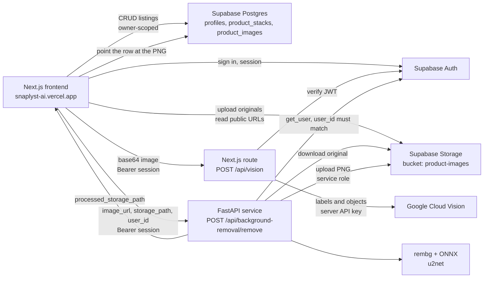

# Snaplyst

[](https://github.com/yuvrajsingh001/snaplyst.ai/actions/workflows/ci.yml)

Snaplyst is a cross-listing workspace for resellers: group product photos into listings, strip backgrounds, and export ready-to-upload CSVs for Depop and Shopify.

**Live demo:** [https://snaplyst-ai.vercel.app](https://snaplyst-ai.vercel.app)

## Demo

> **TODO (demo media):** Add a short GIF or MP4 of the real product flow before sharing this repo widely.
>
> Suggested capture: sign in on the live app, drop a few product photos, sort them into a stack, remove a background, then export a Depop or Shopify CSV.
>
> When the file is in the repo, embed it here:
>
> ``
>
> or `<video src="docs/demo.mp4" controls></video>`

## Features

- Email sign-up and sign-in through Supabase Auth, with per-user product data protected by row-level security
- Drag-and-drop photo upload into a private `product-images` storage bucket
- Automatic grouping of similar photos into product stacks, using Google Cloud Vision labels and cosine similarity
- One-click background removal (and undo) via a FastAPI service running rembg / ONNX
- Listing fields for price, brand, condition, size, colour, and channel-specific Depop and Shopify settings
- CSV export that follows the official Depop and Shopify templates, including multi-image and multi-variant Shopify rows

## Architecture

The browser talks to Supabase for auth, data, and file storage. Image similarity goes through a Next.js route that holds the Google Vision key on the server. Background removal is the only call to the Python service. That service checks the caller's Supabase session before it downloads the original, runs the model, and writes the PNG back with the service role key.



Background removal request path:

1. The frontend checks storage for an existing `*_bg_removed.png` and reuses it when present.
2. Otherwise it `POST`s the public image URL, the original storage path, and the signed-in user id to `/api/background-removal/remove`, with the Supabase access token in `Authorization`.
3. FastAPI resolves that token with `auth.get_user`, rejects a mismatch with `user_id`, and only then downloads the bytes, runs `rembg` with the `u2net` session, and uploads a PNG under that user's folder.
4. The frontend saves `processed_storage_path` on the `product_images` row. Undo restores the original path and keeps the PNG for the next time.

## Tech stack

| Layer | Choice |
| --- | --- |
| Frontend | Next.js 16, React 19, TypeScript, Tailwind CSS, TanStack Query |
| Auth, database, storage | Supabase (Postgres, Auth, Storage) |
| Background removal | FastAPI, rembg, ONNX Runtime, Pillow |
| Image similarity | Google Cloud Vision via `POST /api/vision`, cosine similarity in the browser |
| CSV export | Papa Parse, plus SheetJS for `.xlsx` templates |
| Hosting | Vercel (frontend), Railway-style Python host (API) |
| Tests | Vitest + Testing Library, pytest |
| CI | GitHub Actions, ESLint, Ruff |

## Local setup

Prerequisites: Node.js 20+, pnpm 10, Python 3.11+.

### Frontend

```bash
cd frontend
pnpm install
```

Create `frontend/.env.local` with these names (values stay out of git):

- `NEXT_PUBLIC_SUPABASE_URL`
- `NEXT_PUBLIC_SUPABASE_ANON_KEY`
- `NEXT_PUBLIC_API_URL` — base URL of the FastAPI service, with no trailing path
- `GOOGLE_VISION_API_KEY` — server-only. Do not prefix this with `NEXT_PUBLIC_`. The browser calls `POST /api/vision`, which reads this value.
- `MAINTENANCE_MODE` — optional; set to `true` to serve the maintenance page

```bash
pnpm dev
```

The app runs at `http://localhost:3000`. Supabase project setup is in [SUPABASE_SETUP.md](SUPABASE_SETUP.md). Deployment notes are in [DEPLOYMENT.md](DEPLOYMENT.md).

### Backend

The API is only required for background removal. Listing, auth, and export work against Supabase without it.

```bash
cd backend
python -m venv .venv
source .venv/bin/activate
pip install -r requirements.txt
```

Create `backend/.env` (or export the variables) with these names only:

- `SUPABASE_URL`
- `SUPABASE_SERVICE_ROLE_KEY` — server-side key; never expose this to the browser
- `ALLOWED_ORIGINS` — comma-separated frontend origins. `https://snaplyst-ai.vercel.app` is always allowed

```bash
uvicorn app.main:app --reload --host 0.0.0.0 --port 8000
```

- Health: `http://localhost:8000/health`
- Interactive docs: `http://localhost:8000/docs`

`requirements.txt` installs rembg and ONNX Runtime, which are large. The test requirements below do not.

## Tests

CI lints and tests both apps. Background-removal tests mock rembg, ONNX, and the Supabase client, so they do not download models.

```bash
# Frontend unit tests and lint
cd frontend
pnpm test
pnpm lint

# Backend unit tests and lint
cd backend
python -m venv .venv && source .venv/bin/activate
pip install -r requirements-dev.txt
ruff check .
pytest
```

## Roadmap

- Add eBay and Poshmark export templates next to Depop and Shopify.
- Queue batch background removal with per-image progress instead of sequential browser requests. `POST /api/background-removal/remove-batch` still returns base64 and does not upload with the service role key.
- Suggest price, title, and category from the Vision labels already stored on each photo.

## Project layout

```
frontend/     Next.js app (App Router)
backend/      FastAPI background-removal service
.github/      GitHub Actions CI
```

[DEVELOPER_WORKFLOW.md](DEVELOPER_WORKFLOW.md) walks through the current request paths: auth, upload, the Vision route, background removal, and CSV export.
